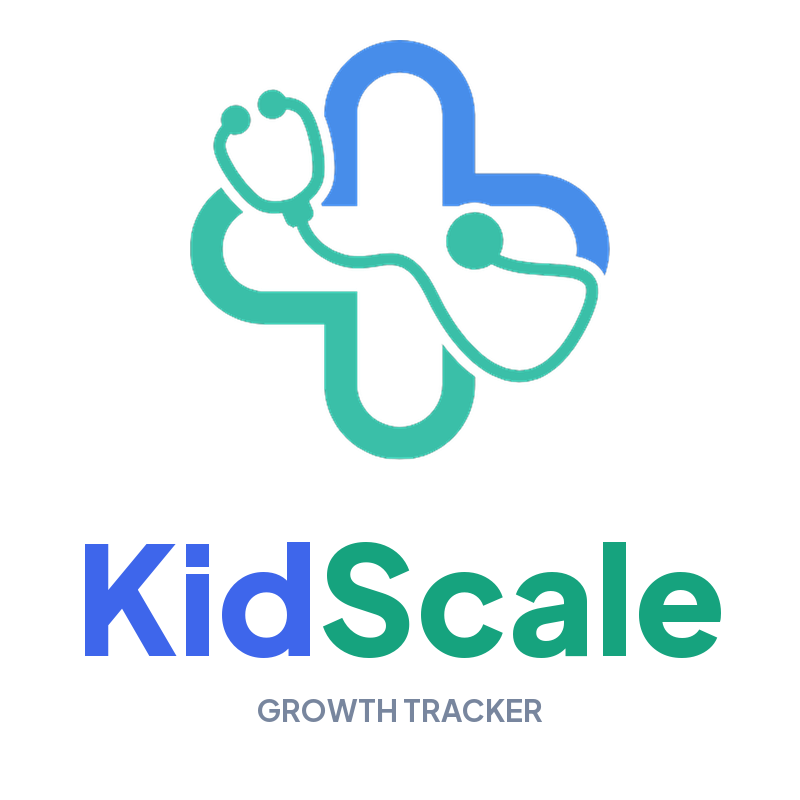

<h1 align="center">KidScale</h1>

A mobile app for tracking child growth and development, helping families prevent stunting.

<em>Formerly STANTAPP.</em>

## Features

- Manage records for multiple children.
- Track children's height, weight and head circumference over time.
- Follow vaccination schedules and record completed immunizations.
- Read up-to-date child health articles.
- Keep data privately on the device, with no account required.

## Development

- Install `fvm` by following the [official instructions](https://fvm.app/documentation/getting-started/installation).
- Before starting any development, run `init.sh`.
- To publish a binary for testing or production, run `publish.sh`.

Follow these instructions to generate and sign the app with a keystore: [Flutter Android Deployment Guide](https://docs.flutter.dev/deployment/android).
